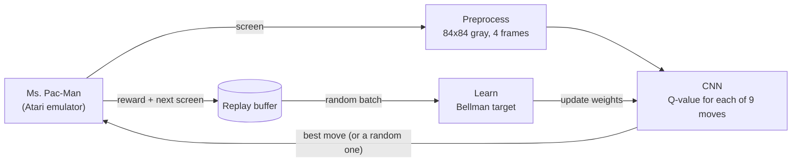

# Ms. Pac-Man DQN

A deep reinforcement learning agent that learns to play **Ms. Pac-Man** from raw screen pixels, written from scratch in PyTorch. It learns only from the game score: no hand-written rules, no human demonstrations.

[](https://colab.research.google.com/github/<your-username>/<your-repo>/blob/main/pacman_dqn_colab_v2.ipynb)


> Replace `<your-username>/<your-repo>` in the Colab badge link with your own GitHub path.

## Contents

- [How it works](#how-it-works)
- [What's in this repo](#whats-in-this-repo)
- [Quick start: Google Colab (recommended)](#quick-start-google-colab-recommended)
- [Quick start: run locally](#quick-start-run-locally)
- [Settings you can change](#settings-you-can-change)
- [Results](#results)
- [Troubleshooting](#troubleshooting)
- [Limitations](#limitations)
- [References](#references)
- [License](#license)

## How it works

The agent plays the Atari version of Ms. Pac-Man through the Arcade Learning Environment (ALE). It repeats one loop thousands of times:



1. **See.** The screen is shrunk to 84x84 grayscale, and the last 4 frames are stacked so the network can see motion.
2. **Decide.** A convolutional neural network outputs a Q-value (expected future reward) for each of the 9 joystick actions. The agent picks the highest, except for a shrinking fraction of random "exploration" moves.
3. **Remember.** Every step is stored in a replay buffer.
4. **Learn.** Random batches from memory train the network so that its prediction matches *reward now + discounted value of the best next move* (the Bellman equation). A slowly updated copy of the network (the target network) keeps this stable.

Rewards are clipped to +1 / 0 / -1 so large point values (such as eating a ghost) don't dominate learning. Scores in the logs are always the real game score.

### Two versions of the agent

| | **Local scripts** (`train.py`) | **Colab notebook v2** |
|---|---|---|
| Algorithm | DQN with Double-DQN targets | Double DQN + **dueling** heads + **3-step returns** |
| Network | Nature-DQN CNN (32/64/64 channels) | Larger CNN (64/128/128 + 2 extra conv layers; configurable) |
| Replay buffer | 50,000 steps | **500,000 steps** (each frame stored once) |
| Life lost | Game continues, no special signal | Treated as an episode end for learning |
| Learning rate | Constant | Linear decay (1e-4 to 1e-5) |
| Choosing the best model | Average of the last 20 training games | **Fixed-seed evaluation** (mean ± standard error) |
| Saving | `checkpoints/` | Google Drive, with **auto-resume** after disconnects |
| Monitoring | Console, CSV, optional TensorBoard | TensorBoard, curve, in-notebook video |

The local scripts are the simpler, easier-to-read baseline. The notebook is the stronger, more complete version.

## What's in this repo

```
.
├── README.md
├── requirements.txt
├── pacman_dqn_colab_v2.ipynb   improved version for Google Colab
│
├── config.py                   all settings in one place
├── env.py                      creates and preprocesses the game
├── model.py                    the neural network (QNet)
├── replay_buffer.py            the agent's memory
├── agent.py                    action choice and the learning step
├── train.py                    main training script
├── evaluate.py                 fixed-seed scoring of a saved model
├── watch.py                    watch (or record) a trained model
├── plot.py                     learning curve from logs/scores.csv
├── live_plot.py                live-updating learning curve
├── visualize.py                filters, feature maps, Q-values, saliency
├── check_setup.py              verifies your installation
├── play_human.py               play Ms. Pac-Man yourself
└── play_screen.py              (experimental) let the model play a game window
```

Folders created while running: `checkpoints/` (saved models), `logs/` (scores, graphs, TensorBoard data) and `videos/` (recordings). Add them to `.gitignore`:

```gitignore
venv/
__pycache__/
checkpoints/
logs/
videos/
*.pt
```

## Quick start: Google Colab (recommended)

Training needs a GPU. Colab provides one for free.

1. Click the **Open in Colab** badge at the top, or upload `pacman_dqn_colab_v2.ipynb` at [colab.research.google.com](https://colab.research.google.com).
2. Choose **Runtime > Change runtime type > T4 GPU**.
3. Run the cells in order: install, connect Google Drive, settings, memory, network and agent, training functions.
4. Run the **smoke test** cell (a few minutes) to confirm everything works.
5. Run the **Train** cell.

Checkpoints and logs are saved to `MyDrive/pacman_dqn/<run_name>/`. If Colab disconnects, reconnect, re-run the setup cells and the Train cell again: it resumes from the last checkpoint. To stop on purpose, use **Runtime > Interrupt execution**; progress is saved first.

The notebook has cells for a live TensorBoard dashboard, the learning curve, a 100-game comparison of `best.pt` and `latest.pt`, and a video of the agent playing.

## Quick start: run locally

**Requirements:** Python 3.10 to 3.12. An NVIDIA GPU is strongly recommended; on a CPU, training takes days.

```bash
git clone https://github.com/<your-username>/<your-repo>.git
cd <your-repo>

python -m venv venv
source venv/bin/activate        # Windows: venv\Scripts\activate

pip install -r requirements.txt
```

If you have an NVIDIA GPU, install PyTorch with the command from [pytorch.org](https://pytorch.org) first, because the default build can be CPU-only on some systems.

`requirements.txt`:

```text
gymnasium[atari]>=1.0.0
torch
numpy
matplotlib
pygame
moviepy
```

The Ms. Pac-Man game files come bundled with `ale-py`, which `gymnasium[atari]` installs, so there is no separate game download.

### Run it

```bash
python check_setup.py                  # verify the install (prints "Setup OK")
python train.py --steps 100000         # short test run
python train.py                        # full training (2M steps by default)

python plot.py                         # learning curve -> logs/training_curve.png
python evaluate.py --model checkpoints/best.pt --games 50
python watch.py --model checkpoints/best.pt --episodes 3
python watch.py --record               # save videos to ./videos (works without a screen)

python play_human.py                   # play the game yourself (arrow keys or WASD)
```

Watch training live in a second terminal:

```bash
pip install tensorboard
tensorboard --logdir logs/tb           # then open http://localhost:6006
```

### Checkpoints

| File | Meaning |
|---|---|
| `best.pt` | Best model according to the saving rule of that version |
| `latest.pt` | Most recent periodic snapshot |
| `final.pt` | Model at the very end of training (local scripts) |

A `.pt` file holds only network weights (plus resume data in the notebook version). It does not contain any recorded game. Loading it and playing starts a **new** game each time.

## Settings you can change

Local scripts: edit `config.py`. Notebook: edit the `Config` class.

| Setting | Default (local / notebook) | What it does |
|---|---|---|
| `TOTAL_STEPS` / `total_steps` | 2M / 6M | Agent decisions to train for (each = 4 game frames) |
| `BUFFER_SIZE` / `buffer_size` | 50k / 500k | Replay memory size. Lower it if you run out of RAM |
| `LEARNING_RATE` / `lr` | 1e-4 | Learning rate (the notebook decays it to 1e-5) |
| `GAMMA` / `gamma` | 0.99 | How much future rewards matter |
| `EPS_END` / `eps_end` | 0.05 / 0.02 | Final chance of a random move |
| `EPS_DECAY_STEPS` / `eps_decay_steps` | 1M | How long exploration takes to fade |
| `hidden_sizes` (notebook) | `(512,)` | Fully connected layers in each head |
| `conv_channels`, `extra_conv` (notebook) | `(64,128,128)`, `2` | Size of the convolutional network |
| `eval_games` (notebook) | 20 | Games per evaluation |

A checkpoint only loads into a network with the **same layout**. If you change the network size, start a new run folder.

## Results

Scores are real Ms. Pac-Man game scores. Training is noisy: a single game can vary widely, so averages over many games on fixed seeds are the fair way to compare models.

| Agent | Average score | How measured |
|---|---|---|
| Random player | about 250 | A few games with random moves |
| Local DQN (2M steps) | roughly 1,550 to 1,650 | `evaluate.py`, 50 games; repeated runs of the same model differed by up to about 75 |
| Colab v2 (during training) | roughly 2,200 to 2,500 | Evaluations of 10 games each, so very noisy (± about 185) |

Fill in your own final numbers after running the 100-game comparison cell, and add a learning-curve image (`logs/training_curve.png`) here:

```markdown

```

**Reading the numbers.** Differences smaller than about twice the reported ± value are not meaningful. The notebook reports mean ± standard error for this reason, and picks `best.pt` by evaluation rather than by a lucky stretch of training games.

## Troubleshooting

| Problem | Fix |
|---|---|
| `Namespace ALE not found` | The line `gym.register_envs(ale_py)` is missing, or gymnasium is older than 1.0. Run `pip install -U "gymnasium[atari]"` |
| Training says `cpu` instead of `cuda` | PyTorch was installed without GPU support, or the Colab GPU runtime is off |
| Out of memory / session crashes | Lower `buffer_size` |
| Game window doesn't open | You may be on a machine without a screen (Colab, SSH). Use `python watch.py --record` |
| Window opens but keys do nothing | Click inside the window; on macOS allow your terminal under Privacy & Security > Input Monitoring |
| Size mismatch when loading a `.pt` file | The network layout in the config differs from the one the model was trained with |
| Score flat for a long time | Normal for the first several hundred thousand steps; judge progress over millions of steps |

## Limitations

- **Sticky actions.** The environment (`ALE/MsPacman-v5`) repeats the previous move 25% of the time, which makes the game random and caps the achievable score.
- **Modest scores.** DQN-style methods learn Ms. Pac-Man slowly. Published results use far more training than a free Colab session allows.
- **The replay buffer is not saved,** so a resumed run refills its memory (about 20,000 steps) before learning restarts.
- **Different game, different training.** A model trained here only works on this emulator's graphics. It will not play other Pac-Man versions without retraining. `play_screen.py` is an experiment that approximates key presses from screen captures and is not expected to match emulator-level performance.
- **Online games.** Don't use screen-reading bots in online or competitive games; it can break their terms of service.

## References

- Mnih et al., *Human-level control through deep reinforcement learning*, Nature, 2015 (DQN)
- van Hasselt et al., *Deep Reinforcement Learning with Double Q-learning*, AAAI, 2016
- Wang et al., *Dueling Network Architectures for Deep Reinforcement Learning*, ICML, 2016
- Hessel et al., *Rainbow: Combining Improvements in Deep Reinforcement Learning*, AAAI, 2018
- Bellemare et al., *The Arcade Learning Environment: An Evaluation Platform for General Agents*, JAIR, 2013
- Machado et al., *Revisiting the Arcade Learning Environment*, JAIR, 2018 (sticky actions)
- [Gymnasium](https://gymnasium.farama.org/), [ALE / ale-py](https://github.com/Farama-Foundation/Arcade-Learning-Environment), [PyTorch](https://pytorch.org/)

## License

Add a license file (for example MIT) and name it here. The Arcade Learning Environment, Stella and the bundled game files have their own licenses; check them before redistributing anything.
